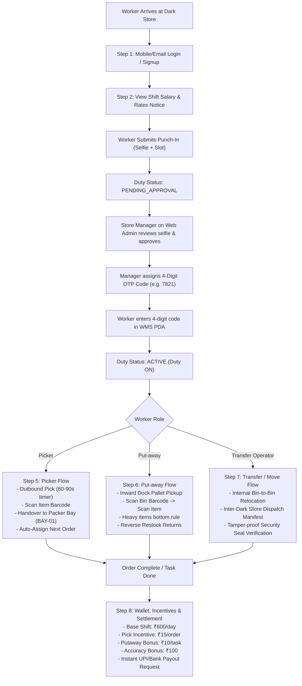

# ================================================================================
#          DARK STORE & WMS MOBILE APP WORKFLOW SPECIFICATION DOCUMENT
# ================================================================================
# System Type: Dark Store / Warehouse Management System (Zepto / Blinkit model)
# Platforms: Mobile App (Worker PDA / Handheld) & Web Admin (Store Manager)
# Document Version: 2.4

---

## 📋 Table of Contents
1. [High-Level Flowchart](#1-high-level-flowchart)
2. [Step-by-Step Complete Operational Pipeline](#2-step-by-step-complete-operational-pipeline)
   - [Step 1: Authentication & Account Setup](#step-1-authentication--account-setup)
   - [Step 2: Salary Notice, Punch-In Request & Manager OTP Approval](#step-2-salary-notice-punch-in-request--manager-otp-approval)
   - [Step 3: Shift Slot Booking & Attendance History](#step-3-shift-slot-booking--attendance-history)
   - [Step 4: Main Dashboard & Worker Profile](#step-4-main-dashboard--worker-profile)
   - [Step 5: Picker Flow (Order Fulfilment & Handover)](#step-5-picker-flow-order-fulfilment--handover)
   - [Step 6: Put-away Flow (Purchase Inbound & Customer Return)](#step-6-put-away-flow-purchase-inbound--customer-return)
   - [Step 7: Transfer / Move Flow (Internal Shelf-to-Shelf & Store-to-Store)](#step-7-transfer--move-flow-internal-shelf-to-shelf--store-to-store)
   - [Step 8: Wallet, Incentives & Settlement](#step-8-wallet-incentives--settlement)
3. [Comprehensive System Database Schema](#3-comprehensive-system-database-schema)
4. [Docker Deployment & Infrastructure Topology](#4-docker-deployment--infrastructure-topology)

---

## 1. High-Level Flowchart



---

## 2. Step-by-Step Complete Operational Pipeline

### Step 1: Authentication & Account Setup
- **Mobile & Email Sign-In:** Workers log in with mobile number/email and password.
- **Role Assignment:** Supports Picker, Put-away Associate, Inward Associate, Packer, and Store Manager.
- **Account Registration:** Sign-up form with instant password hashing (bcrypt) and staff linking.
- **Forgot Password:** Self-service password reset via registered mobile/email.
- **Hardware Integration:** Compatible with handheld Android PDAs (Zebra TC21/TC26, Honeywell ScanPal, Newland).

### Step 2: Salary Notice, Punch-In Request & Manager OTP Approval
- **Shift Salary & Rate Notice:** Before punching in, the official rate card is displayed:
  - Base Daily Wage: **₹600 / 8-hour shift**
  - Outbound Picking Incentive: **₹15 / order**
  - Put-away Bonus: **₹10 / placement**
  - 100% Accuracy Bonus: **₹100 / shift**
  - Damage / Shortage Penalty: **-₹50 / item**
- **Punch-In Submission:** Worker takes a live selfie (uploaded to MinIO S3 `wms-attendance`) and selects shift slot.
- **Approval Queue:** Duty state set to `PENDING_APPROVAL`.
- **Manager Approval:** Store Manager navigates to Web Admin (`/admin/duty-records`), reviews the punch-in, and clicks Approve. A unique **4-digit PIN** is generated.
- **Verification:** Worker enters the 4-digit code in the PDA app -> triggers `POST /api/auth/verify-duty-code` -> status becomes `ACTIVE` (`Duty ON`), slot clock starts, and auto-assignment activates.

### Step 3: Shift Slot Booking & Attendance History
- **Slot Availability:** Real-time visibility into dark store shift slots:
  - *Morning Shift:* 06:00 AM – 02:00 PM (Standard + ₹50 Early bird)
  - *General Shift:* 09:00 AM – 06:00 PM
  - *Afternoon Shift:* 02:00 PM – 10:00 PM (Peak order rush bonus)
  - *Night Shift:* 10:00 PM – 06:00 AM (Night allowance +₹120)
- **Advance Booking:** Workers can book shift slots for upcoming dates.
- **Attendance Ledger:** Full historical log showing Date, Shift Name, Punch-In Time, Punch-Out Time, Total Hours, Manager Approval Code, and Status.

### Step 4: Main Dashboard & Worker Profile
- **PDA Dashboard Controls:** Duty ON/OFF switch, Break toggle (Tea/Lunch), Shift duration counter.
- **Worker Profile Card:** Displays name, contact number, role badge, Staff ID, Dark Store Location, and verified Bank/UPI details.
- **Live Performance Scorecard:** Today's Orders Fulfilled, Average Pick Speed (seconds per item), and Accuracy Percentage (e.g. 99.4%).

### Step 5: Picker Flow (Order Fulfilment & Handover)
- **Target Timer:** 60–90 seconds countdown per item to meet dark store delivery SLA (10-minute delivery model).
- **Location-Directed Picking:** Exact shelf bin location displayed (`Aisle-X-Rack-Y-Bin-Z`).
- **Barcode Validation:** Worker scans item barcode with PDA hardware laser or camera. Audible beep confirms match; wrong items are immediately rejected.
- **Customer Return Picking:** Dedicated subtab for picking customer returns from storage bins to the Return Dock.
- **Handover to Packer Bay:** Upon completing order picking, the app displays a Handover Slip with crate barcode `HO-ORD-XXXX` and destination packer bay (`BAY-01`, `BAY-02`).
- **Instant Auto-Assignment:** The moment picking is completed, the system auto-assigns the next order from the pending pool.

### Step 6: Put-away Flow (Purchase Inbound & Customer Return)
- **Inward Dock Clearance:** Receive pallets from dock staging area.
- **Dual-Scan Verification:** Worker scans Bin barcode first, then Item barcode to confirm correct placement.
- **Stock Hygiene Rules:**
  - *Heavy Items (>5kg):* Bottom level / Level 1 shelves.
  - *Light & Fragile Items:* Level 3/4 upper shelves.
- **Reverse Put-away:** Restock returned or cancelled items back to active shelf bins.

### Step 7: Transfer / Move Flow (Internal Shelf-to-Shelf & Store-to-Store)
- **Internal Shelf Move:**
  - Scan Source Shelf -> Scan Item Barcode -> Enter Move Qty -> Scan Target Shelf.
  - Reason tracking: Consolidation, Relocation, Hygiene Re-rack, Damage Isolation.
  - Creates `StockMovements` record with type `INTERNAL_SHELF`.
- **Store-to-Store (Dark Store) Dispatch:**
  - Select Destination Dark Store, Variant, Qty, Transporter Fleet, Vehicle Number.
  - Generates tamper-proof **Security Seal Barcode** (e.g. `SEAL-8891`) and Transfer Manifest (`STO-YYYYMMDD-XXXX`).
- **Inbound Store Receive:**
  - Destination store scans incoming transfer manifest and verifies the security seal barcode.
  - Confirms put-away into local dark store shelf.

### Step 8: Wallet, Incentives & Settlement
- **Worker Wallet:** Aggregates Base Daily Wage + Order Pick Incentives + Putaway Bonuses + Accuracy Bonuses.
- **Instant Payout Request:** Worker can request payout via UPI (GPay, PhonePe, Paytm) or Bank NEFT/IMPS.
- **Store Manager Payout Desk:** Store Lead and SuperAdmin on Web Admin (`/admin/payouts`) review earnings, approve payouts, and record bank UTR reference numbers.

---

## 3. Comprehensive System Database Schema

Implemented in PostgreSQL using Prisma ORM:

```prisma
model DutyRecords {
  DutyID         Int       @id @default(autoincrement())
  StaffID        Int
  UserID         Int
  ShiftSlot      String?   // 'Morning', 'General', 'Night', 'Afternoon'
  Date           DateTime  @default(now())
  PunchInTime    String?
  PunchOutTime   String?
  SelfieUrl      String?
  ApprovalStatus String    @default("PENDING_APPROVAL")
  ApprovalCode   String?   // 4-digit code generated by Manager
  ApprovedByID   Int?
  ApprovedAt     DateTime?
  TotalHours     Float?    @default(0)
  Notes          String?
  CreatedAt      DateTime  @default(now())
  UpdatedAt      DateTime  @updatedAt
}

model StaffPayouts {
  PayoutID      Int       @id @default(autoincrement())
  StaffID       Int
  UserID        Int
  Role          String    // 'picker', 'manager', 'packer', etc.
  TotalShifts   Int       @default(1)
  TotalHours    Float     @default(8.0)
  BasePay       Float     @default(0.0)
  Incentive     Float     @default(0.0)
  TotalAmount   Float     @default(0.0)
  Status        String    @default("PENDING") // 'PENDING', 'PROCESSED', 'PAID'
  PaymentMethod String?   // 'UPI', 'BANK_TRANSFER', 'CASH'
  PaymentRef    String?   // Bank UTR or Transaction ID
  PaidAt        DateTime?
  ProcessedByID Int?
  Notes         String?
  CreatedAt     DateTime  @default(now())
  UpdatedAt     DateTime  @updatedAt
}

model StockMovements {
  MovementID    Int       @id @default(autoincrement())
  VariantID     Int
  FromStoreID   Int
  ToStoreID     Int
  FromShelf     String?
  ToShelf       String?
  Qty           Int?
  Type          String?   // 'INTERNAL_SHELF', 'STORE_TO_STORE_DISPATCH', 'STORE_TO_STORE_RECEIVE'
  TransferNo    String?   // e.g. STO-20261102-1234
  Transporter   String?
  VehicleNo     String?
  SealNo        String?
  Reason        String?
  Status        String?   @default("COMPLETED")
  Date          DateTime? @default(now())
  CreatedBy     Int?
  CreatedByName String?
}

model ShiftAssignments {
  AssignmentID Int       @id @default(autoincrement())
  StaffID      Int
  ShiftID      Int
  Date         DateTime?
  SlotName     String?   // 'Morning', 'Afternoon', 'Night', 'General'
  Status       String?   @default("BOOKED")
}
```

---

## 4. Docker Deployment & Infrastructure Topology

| Service | Container Name | Host Port | Internal Port | Technology | Purpose |
| :--- | :--- | :--- | :--- | :--- | :--- |
| **WMS Handheld App** | `major_wms` | **3001** | 3001 | Node.js / Express / Socket.io | Worker PDA mobile web application |
| **Web Admin & E-Commerce** | `major_app` | **3000** | 3000 | Node.js / Express / Vue.js | Store Manager Desk, Duty Approvals, Payouts |
| **Database** | `major_postgres` | **5432** | 5432 | PostgreSQL 16 Alpine | Relational schema with Prisma ORM |
| **Caching & Pub/Sub** | `major_redis` | **6379** | 6379 | Redis Alpine | Auto-assignment engine, state locks & duty sessions |
| **Object Storage** | `major_minio` | **9000, 9001** | 9000, 9001 | MinIO S3 | Selfie punch-ins, damage proofs, pallet slips |

### Run Command:
```bash
docker compose up -d --build
```
